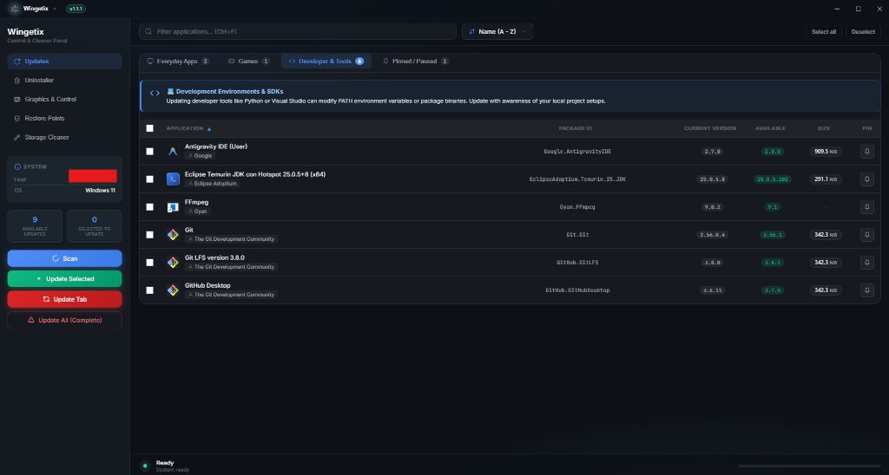

<div align="center">

  

  # Wingetix

  ### *The Ultimate Visual Control Panel for Windows Software & Modern WinGet GUI*

  [](https://github.com/joselyky/Wingetix/releases/latest)
  [](https://github.com/joselyky/Wingetix/releases)
  [](https://github.com/joselyky/Wingetix/stargazers)
  [](https://wingetix.com)
  [](https://github.com/joselyky/Wingetix)
  [](LICENSE)

  <br />

  <p align="center">
    <b>Wingetix</b> transforms the official Microsoft Windows Package Manager (<code>winget</code>) into a sleek, responsive, and intuitive desktop experience. Scan installed programs in seconds, 1-click batch update all outdated software, deeply uninstall bloatware without leaving registry residue, and safeguard your PC with native system restore points and launcher armor.
  </p>

  <p align="center">
    <a href="https://wingetix.com"><strong>Official Website »</strong></a> •
    <a href="#-download--installation"><strong>Download App »</strong></a> •
    <a href="#-key-features">Key Features</a> •
    <a href="#-why-wingetix-comparison">Comparison</a> •
    <a href="#-security--guaranteed-privacy">Security & Trust</a> •
    <a href="#-build-from-source">Build from Source</a>
  </p>

  <br />

  <p align="center">
    
  </p>

</div>

---

## ⚡ Quick Install via Windows Terminal

You can install Wingetix with a single terminal command via Microsoft WinGet:

```powershell
winget install wingetix
```

*(Or download the standalone GUI installer from [Releases](https://github.com/joselyky/Wingetix/releases/latest) or [wingetix.com](https://wingetix.com)).*

---

## 💡 What is Wingetix?

Microsoft WinGet is powerful, but running PowerShell, remembering command flags, and inspecting silent installer parameters can be intimidating or time-consuming.

**Wingetix** bridges that gap by offering:
1. **Centralized Software Hub:** Manage all your desktop software inside a fluid *Windows 11 Glassmorphism* dark interface with GPU acceleration.
2. **Automated Update Discovery:** Scans installed software and cross-references against Microsoft's official verified catalog of 12,000+ packages in seconds.
3. **Deep Residual Cleaner:** Traces and purges orphaned directories in `%AppData%`, `%LocalAppData%`, `ProgramData`, and leftover Windows Registry keys.
4. **Platform Shield:** Armors game launchers (**Steam, Epic Games, Riot, EA App, Ubisoft Connect**) to prevent accidental file deletion or library corruption.
5. **Storage & Cache Cleaner:** Reclaims wasted disk space by sweeping WinGet installer caches, crash dumps, and setup residue.
6. **Package Pinning:** Locks specific applications to their current version to prevent unwanted upgrades.
7. **Built-in Auto-Updater:** Checks for updates securely via GitHub Releases with 1-click upgrade and live download telemetry.

---

## 🌟 Key Features

### 🔄 1. Batch Upgrades & Real-Time Queue
- **Rapid System Scan:** Evaluates all installed programs against the official repository in under 5 seconds.
- **1-Click Bulk Updates:** Upgrade individual apps or queue every outdated application simultaneously.
- **Cancel Anytime:** Dynamic cancel button safely halts active batch operations or downloads.
- **Smart Filtering:** Instant search bar and category filters (Apps, Games, Developer tools).
- **Live Output Stream:** Expandable terminal log displaying raw WinGet console streams in real time.

### 🧹 2. Storage & Cache Cleaner
- **WinGet Installer Scrubbing:** Automatically detects and purges cached `.exe`, `.msi`, and `.msix` setup packages.
- **Crash Dumps & Temp Files:** Sweeps user `%TEMP%`, Windows Error Reporting dumps (`.dmp`), and setup leftovers.
- **🛡️ Active Process Shield:** Safely skips files locked by active background processes to avoid system locks or crashes.
- **Visual Disk Telemetry:** Real-time reclaimed byte counters, cleanup animations, and direct "Open Folder" explorer links.

### 📌 3. Package Pinning & Version Freezing
- **Version Lock:** Exclude specific packages from update notifications via native `winget pin`.
- **Preserve Compatibility:** Perfect for enterprise software, specialized plugins, or graphics drivers that require fixed versions.
- **Dedicated Pinned Manager:** Easily inspect and unfreeze pinned software at any time.

### 🗑️ 4. Clean Uninstaller with Platform Shield
- **Deep Orphan Purge:** Analyzes `%ProgramFiles%`, `%AppData%`, `%LocalAppData%`, and the Windows Registry (`HKLM` / `HKCU`).
- **Platform Shield Integration:** Protects **Steam, Epic Games, Ubisoft Connect, EA App, Riot Vanguard, Battle.net, and GOG Galaxy**. Safely uninstall games without risking launcher corruption or collateral damage to your game library.

### 🎮 5. GPU Telemetry & Official Driver Suites
- **Adapter Detection:** Automatic hardware recognition for **NVIDIA GeForce**, **AMD Radeon**, and **Intel Arc / Iris** GPUs.
- **Live Hardware Sensors:** Real-time VRAM allocation, GPU core temperatures, display resolution, and power metrics.
- **Official Driver Shortcuts:** Direct access to manufacturer suites (GeForce Experience / NVIDIA App, AMD Software Adrenalin, Intel Graphics Command Center).

### 💾 6. Windows System Restore Points
- **Pre-emptive OS Snapshots:** Create complete Windows System Restore points before installing drivers or removing software.
- **Snapshot Manager:** Review existing restore points, clean older snapshots to reclaim disk space, or launch `rstrui.exe` directly.

---

## 📊 Why Wingetix? (Comparison)

| Feature | Wingetix | WinGet CLI | Generic Cleaners (CCleaner, etc.) |
| :--- | :---: | :---: | :---: |
| **User Interface** | Modern Windows 11 Glassmorphism | Console / PowerShell only | Dated, ad-heavy UI |
| **Official Microsoft Sources** | ✅ 100% Verified Catalog | ✅ Yes | ❌ Proprietary / Unknown mirrors |
| **Package Catalog** | 12,000+ Packages | 12,000+ Packages | Limited curated catalog |
| **1-Click Bulk Updates** | ✅ Yes (Interactive Queue) | ⚠️ Manual `upgrade --all` | Paid / Premium paywall |
| **Platform Shield (Game Protection)** | ✅ Built-in | ❌ None | ❌ None (Risks wiping games) |
| **Storage & Installer Cleaner** | ✅ Built-in | ❌ None | ⚠️ Aggressive / Deletes valid keys |
| **Package Pinning (Freeze Versions)** | ✅ Visual Tab | ⚠️ CLI flag only | ❌ None |
| **System Restore Integration** | ✅ Native `rstrui.exe` | ❌ None | ⚠️ Paid version only |
| **Privacy & Telemetry** | 🔒 100% Local (Zero Tracking) | 🔒 Microsoft Telemetry | ❌ Aggressive ad tracking |
| **License & Price** | 🆓 **100% Free & Open Source (GPLv3)** | 🆓 Free | 💰 Adware / Subscription nag screens |

---

## 🛡️ Security, Trust & Guaranteed Privacy

Wingetix is engineered under a **zero-malware tolerance, full transparency, and local-first** standard:

- 🔒 **SHA-256 Hash Verification:** Every installer downloaded is verified against official cryptographic hashes before execution.
- 🌐 **Zero Middlemen:** Binaries are fetched directly from official developer CDNs and Microsoft infrastructure (no repackaged installers).
- 🛡️ **Explicit User Consent:** Nothing updates or deletes silently in the background. Every action requires your explicit confirmation.
- 💻 **100% Local Execution:** No user accounts, no passwords collected, and no analytics harvesting. Everything runs locally on your PC.
- 📜 **GNU GPLv3 Open Source:** All source code is completely public and auditable by the community.

---

## 🖥️ Interface Modules

| Module | Icon | Purpose |
| :--- | :---: | :--- |
| **Updates Hub** | 🔄 | Scan outdated software, apply filters, and trigger 1-click batch upgrades. |
| **Clean Uninstaller** | 🗑️ | Detailed software registry with deep leftover folder and registry key cleaner. |
| **Storage Cleaner** | 🧹 | Scan and purge installer caches, temporary setup files, and crash dumps. |
| **Package Pinning** | 📌 | Freeze versions and exclude specific packages from update notifications. |
| **GPU Telemetry** | 🎮 | Live hardware monitor for GPU thermals, VRAM usage, and driver links. |
| **Restore Points** | 💾 | Create and manage native Windows System Restore snapshots (`rstrui.exe`). |
| **Auto-Updater** | 🚀 | Seamlessly downloads and applies new official releases from GitHub. |

---

## 📥 Download & Installation

### Option 1: Microsoft WinGet (Terminal) — Fastest
```powershell
winget install wingetix
```

### Option 2: Guided Installer (.exe) — Recommended
Download **`Wingetix.Setup.1.1.1.exe`** from [**GitHub Releases**](https://github.com/joselyky/Wingetix/releases/latest) or [**wingetix.com**](https://wingetix.com).
- Guided setup wizard with desktop shortcut creation.
- Automatically configures `winget` in your terminal if absent.
- Full clean uninstallation support from the Windows Control Panel.

### Option 3: Portable Standalone (.exe)
Download **`Wingetix.1.1.1.exe`** for standalone execution without installation (ideal for IT maintenance flash drives).

---

## ⚙️ System Requirements

- **Operating System:** Windows 10 (version 1809+) or Windows 11 (64-bit).
- **WinGet CLI:** Built into modern Windows 10 & 11 *(automatically enabled if absent)*.
- **Permissions:** Standard user privileges for scanning/updates; Administrator elevation (UAC) only when cleaning system-wide registry keys or creating restore points.

---

## 🛠️ Build from Source

### Prerequisites
- [Node.js](https://nodejs.org/) (v18.0.0 or higher recommended)
- [Git](https://git-scm.com/)

### Steps
```bash
# Clone the repository
git clone https://github.com/joselyky/Wingetix.git

# Navigate to directory
cd Wingetix

# Install dependencies
npm install

# Run application in development mode
npm start

# Build production installer & portable binaries
npm run build
```

---

## 🤝 Contributing

Contributions, bug reports, and feature requests are welcome!
1. Fork the Project.
2. Create your Feature Branch (`git checkout -b feature/AmazingFeature`).
3. Commit your Changes (`git commit -m 'feat: Add some AmazingFeature'`).
4. Push to the Branch (`git push origin feature/AmazingFeature`).
5. Open a Pull Request.

---

## 📜 License

This project is licensed under the **GNU General Public License v3.0 (GPLv3)**. You are free to inspect, run, modify, and contribute to the code. Any derivative work or redistribution must remain open source under the same GPLv3 license and preserve original author attribution. See the [LICENSE](LICENSE) file for complete details.

<div align="center">
  <sub>Developed with ❤️ by <b><a href="https://github.com/joselyky">Jose Antonio Baeza Pineda (@joselyky)</a></b></sub>
</div>
