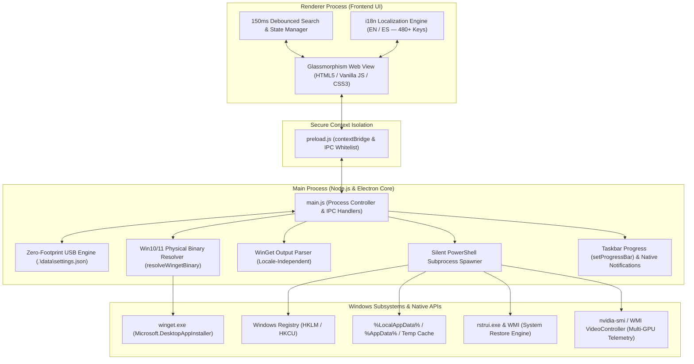

# 📖 Wingetix — Complete Technical & User Documentation

> **Wingetix: The Ultimate Open-Source Visual Control Panel & Software Manager for Windows 10 & 11**  
> *Version: 1.2.0 | License: GNU General Public License v3 (GPLv3)*  
> **100% Free Forever & Open Source (GPLv3) — Zero Ads, Zero Telemetry, No Premium Tier.**

---

## 📑 Table of Contents
1. [Executive Summary & Vision](#1-executive-summary--vision)
2. [High-Level Architecture & Tech Stack](#2-high-level-architecture--tech-stack)
3. [Process Model & Inter-Process Communication (IPC)](#3-process-model--inter-process-communication-ipc)
4. [Deep Dive into Core Application Modules](#4-deep-dive-into-core-application-modules)
   - [4.1 Updates Dashboard & Windows 10/11 WinGet Resolution Engine](#41-updates-dashboard--windows-1011-winget-resolution-engine)
   - [4.2 Clean Uninstaller & Deep Uninstaller v2 (Residual Preview)](#42-clean-uninstaller--deep-uninstaller-v2-residual-preview)
   - [4.3 Platform Shield & Configurable User Whitelist](#43-platform-shield--configurable-user-whitelist)
   - [4.4 Storage & Cache Cleaner](#44-storage--cache-cleaner)
   - [4.5 Multi-GPU Telemetry & Graphics Control](#45-multi-gpu-telemetry--graphics-control)
   - [4.6 Software Packs Studio (.wingetix Bundle Installer)](#46-software-packs-studio-wingetix-bundle-installer)
   - [4.7 System Restore Points Integration](#47-system-restore-points-integration)
   - [4.8 Package Pinning Manager](#48-package-pinning-manager)
   - [4.9 Zero-Footprint USB Portable Mode (.\data\settings.json)](#49-zero-footprint-usb-portable-mode-datasettingsjson)
   - [4.10 Performance, UX & Internationalization (i18n) Engine](#410-performance-ux--internationalization-i18n-engine)
   - [4.11 Visual Glassmorphism Installer](#411-visual-glassmorphism-installer)
5. [Security, Privacy & Why Exclusively Microsoft WinGet](#5-security-privacy--why-exclusively-microsoft-winget)
6. [Directory Structure & Source Code Layout](#6-directory-structure--source-code-layout)
7. [Build, Packaging & Distribution Pipeline (v1.2.0)](#7-build-packaging--distribution-pipeline-v120)
8. [Release History & v1.2.0 Milestone Summary](#8-release-history--v120-milestone-summary)

---

## 1. Executive Summary & Vision

Microsoft Windows has historically lacked a unified, native, visual application manager. While Microsoft introduced the **Windows Package Manager (`winget`)**, its command-line interface poses friction for everyday users and system administrators. Furthermore, legacy Windows maintenance utilities (e.g., CCleaner, IObit Uninstaller) have progressively eroded user trust through persistent background daemons, aggressive paywalls, adware bundles, and invasive telemetry collection.

**Wingetix v1.2.0** resolves this gap. It serves as a modern, hardware-accelerated, glassmorphism desktop control panel that bridges Microsoft's official 12,000+ package catalog with deep system maintenance utilities:
- **Zero Console Popups & Full Windows 10/11 Compatibility:** Resolves physical `winget.exe` binaries directly in `C:\Program Files\WindowsApps` to bypass Windows 10 elevated UAC execution alias bugs, running native WinGet and PowerShell operations invisibly with real-time stream parsing.
- **Deep Uninstaller v2 with Collapsible Residual Preview:** Pre-scans and displays the exact orphan `%AppData%` directories and `HKLM` / `HKCU` registry keys before deletion, allowing granular user deselection.
- **Platform Shield with Configurable User Whitelist:** Armors game launchers (*Steam, Epic Games, Riot Vanguard, EA App, Ubisoft Connect, Battle.net, GOG Galaxy*) and custom user-defined folders against accidental deletion.
- **Software Packs Studio (`.wingetix`):** Builds, exports, and deploys unattended 1-click software bundles preserving real Base64 application icons and automatic dependency detection.
- **Multi-GPU Detection (Dedicated vs Integrated):** Automatically detects and prioritizes discrete GPUs (*NVIDIA GeForce RTX/GTX, AMD Radeon RX, Intel Arc*) alongside integrated graphics (*AMD Radeon Graphics, Intel Iris Xe / UHD*) with instant pill switching.
- **Zero-Footprint USB Portable Mode:** Redirects all settings and Chromium profile data to `.\data\settings.json` and `.\data\profile` when running from a USB flash drive or standalone folder, leaving zero trace in `%APPDATA%` on the host machine.
- **100% Free Forever & Open Source:** Licensed under GNU GPLv3 with zero ads, zero telemetry, and no premium tier.

---

## 2. High-Level Architecture & Tech Stack

Wingetix is built on an asynchronous, multi-process architecture leveraging **Electron** and native Windows subsystems.



### Key Technical Stack:
* **Runtime:** Node.js & Electron (v28+ / Chromium hardware-accelerated rendering).
* **Frontend:** Vanilla JavaScript (ES6+), semantic HTML5, pure CSS3 variables for the Windows 11 Glassmorphism design system (`backdrop-filter: blur()`, CSS Grid, hardware-accelerated transitions, 150ms debounced search inputs).
* **Native Bridges:** Child Process (`spawn`), File System (`fs`), Operating System (`os`), Windows Registry via PowerShell (`Get-ItemProperty`, `Remove-Item`), WMI/CIM (`Win32_VideoController`, `SystemRestore`), Electron Native `Notification` (`AppUserModelId: com.joselyky.wingetix`), and `BrowserWindow.setProgressBar`.
* **Packaging:** `electron-builder` (NSIS guided installer + standalone Portable executable) and Inno Setup (`Wingetix-Setup.iss`).

---

## 3. Process Model & Inter-Process Communication (IPC)

Wingetix strictly enforces Electron's **Context Isolation** security model (`nodeIntegration: false`, `contextIsolation: true`):
1. **Renderer Process (`renderer.js`):** Operates strictly inside a sandboxed browser context with no direct access to Node.js primitives.
2. **Preload Script (`preload.js`):** Exposes a curated whitelist of asynchronous methods via `contextBridge.exposeInMainWorld('electronAPI', api)`.
3. **Main Process (`main.js`):** Listens on `ipcMain.handle` and `ipcMain.on` channels, validates arguments, executes OS-level commands, updates the Windows taskbar progress bar, dispatches native OS notifications, and streams real-time progress back to the UI.

### Key IPC Communication Channels (v1.2.0):
| IPC Channel | Type | Direction | Description |
| :--- | :--- | :--- | :--- |
| `winget:list-upgrades` | `handle` | Renderer ➔ Main ➔ Renderer | Resolves physical `winget.exe`, invokes `winget upgrade`, parses tabular output, and attaches Base64 app icons. |
| `winget:upgrade-packages` | `on` | Renderer ➔ Main | Spawns background `winget upgrade --id <Id>` queue with live MB/s telemetry and taskbar progress. |
| `winget:enable-in-terminal` | `handle` | Renderer ➔ Main ➔ Renderer | Runs `enable-winget.ps1` to install/register `Microsoft.DesktopAppInstaller`, `VCLibs`, and `UI.Xaml` on Windows 10/11. |
| `apps:list-installed` | `handle` | Renderer ➔ Main ➔ Renderer | Enumerates all installed Win32, MSI, and AppX software via `list-installed.ps1` with disk sizes and icons. |
| `apps:preview-residuals` | `handle` | Renderer ➔ Main ➔ Renderer | Pre-scans exact residual directories (`%AppData%`, `ProgramData`) and registry keys (`HKLM`/`HKCU`) prior to uninstallation. |
| `apps:uninstall-clean` | `on` | Renderer ➔ Main | Runs official uninstaller followed by deep heuristic purge while respecting Platform Shield and user exclusions. |
| `shield:get-whitelist` | `handle` | Renderer ➔ Main ➔ Renderer | Retrieves built-in protected ecosystems and user-configured Platform Shield whitelist entries from `settings.json`. |
| `shield:save-whitelist` | `handle` | Renderer ➔ Main ➔ Renderer | Persists custom protected folder paths and keywords into `settings.json`. |
| `bundles:save-pack` | `handle` | Renderer ➔ Main ➔ Renderer | Exports custom software packs as `.wingetix` (with Base64 icons), `.json`, or 1-click `.bat` scripts. |
| `bundles:load-pack` | `handle` | Renderer ➔ Main ➔ Renderer | Imports `.wingetix` or WinGet `.json` manifests into the Software Packs Studio. |
| `bundles:install-pack` | `on` | Renderer ➔ Main | Executes unattended sequential installation of all selected pack applications with live status updates. |
| `gpu:detect-info` | `handle` | Renderer ➔ Main ➔ Renderer | Detects all GPUs (Dedicated & Integrated), driver versions, VRAM, thermals (`nvidia-smi`), and companion suites. |
| `cleaner:scan` / `cleaner:clean` | `handle` | Renderer ➔ Main ➔ Renderer | Scans and purges WinGet download caches, `%TEMP%`, crash dumps, and `C:\Windows\Temp` with active file lock protection. |
| `restore:list` / `restore:create` | `handle` | Renderer ➔ Main ➔ Renderer | Lists, creates (`Checkpoint-Computer`), or deletes Windows System Restore snapshots and launches `rstrui.exe`. |
| `settings:get` / `settings:save` | `handle` | Renderer ➔ Main ➔ Renderer | Reads and writes persistent configuration in `.\data\settings.json` (Portable Mode) or `%APPDATA%\Wingetix\settings.json`. |
| `window:set-progress` | `on` | Renderer ➔ Main | Updates the native Windows 10/11 taskbar icon progress bar (`normal`, `indeterminate`, `error`, or `-1` clear). |
| `app:notify` | `on` | Renderer ➔ Main | Dispatches native Windows Action Center notifications (`com.joselyky.wingetix`) on operation completion. |

---

## 4. Deep Dive into Core Application Modules

*(Ordered matching the v1.2.0 application sidebar navigation)*

### 4.1 Updates Dashboard & Windows 10/11 WinGet Resolution Engine
* **Windows 10 Elevated UAC Alias Bypass (`resolveWingetBinary` & `buildEnv`):** In Windows 10, elevated Administrator processes frequently fail to execute Store App Execution Aliases (`%LOCALAPPDATA%\Microsoft\WindowsApps\winget.exe`) with `ENOENT` or `Access Denied`. Wingetix locates the physical binary inside `C:\Program Files\WindowsApps\Microsoft.DesktopAppInstaller_*_x64__8wekyb3d8bbwe\winget.exe`, injects its directory at the head of `PATH`, and wraps calls through `spawnWinget()` with `shell: true`.
* **1-Click WinGet Activation Assistant (`#modal-winget-activation`):** On Windows 10 LTSC, Enterprise, or systems lacking Microsoft Store registration, Wingetix detects the missing engine and provides a 1-click automated installer for `VCLibs`, `UI.Xaml`, and `Microsoft.DesktopAppInstaller`.
* **Locale-Independent Tabular Parser:** Uses dash-anchor coordinate parsing (`--- --- ---`) to accurately parse WinGet output regardless of the OS display language.

### 4.2 Clean Uninstaller & Deep Uninstaller v2 (Residual Preview)
Traditional Windows uninstallers leave behind gigabytes of orphaned cache folders and registry keys. Wingetix v1.2.0 introduces **Deep Uninstaller v2**:
1. **Pre-Uninstall Collapsible Residual Preview (`apps:preview-residuals`):**
   - When the user clicks **Uninstall**, the confirmation dialog automatically scans and displays a collapsible preview drawer (`#uninstall-residuals-preview-box`) listing every residual disk directory (`%AppData%`, `%LocalAppData%`, `%ProgramData%`, `LocalLow`, Start Menu, install directory) and registry key (`HKLM\SOFTWARE`, `HKCU\Software`, `WOW6432Node`, `App Paths`, `Uninstall`) slated for purge.
   - Each folder and registry key includes an interactive checkbox—allowing users to uncheck specific folders (e.g., saved games or configuration profiles) to preserve them.
   - Paths protected by **Platform Shield** or the user's Whitelist are highlighted in emerald green (`Protected by Platform Shield / Whitelist — Will NOT be touched`).
2. **Stage 1 & Stage 2 Purge with `.reg` Backup:**
   - Runs the official uninstaller first, terminates lingering app-specific processes/services, exports automatic `.reg` backups to `%LOCALAPPDATA%\Wingetix\RegistryBackups`, and purges all approved residuals.

### 4.3 Platform Shield & Configurable User Whitelist
To prevent collateral damage to shared game libraries or critical tools during deep uninstallation:
* **Core Protected Ecosystems (Always Active):** Built-in armor for **Steam (`steamapps`), Epic Games Launcher, Riot Games & Vanguard, EA App / Origin, Ubisoft Connect, Blizzard Battle.net, GOG Galaxy**, and Windows `System32` / drivers.
* **User-Configurable Whitelist (`#modal-platform-shield`):** Accessible directly from the Uninstaller sidebar, users can add custom folder paths (via text input or native folder picker dialog) or registry keywords (e.g., `D:\Games`, `ModOrganizer`, `NexusMods`, `OBS`). Entries are persisted in `settings.json` and enforced by both the residual preview scanner and the PowerShell purge engine.

### 4.4 Storage & Cache Cleaner
Reclaims disk space wasted by setup packages and temporary buffers:
* **WinGet Installer Cache:** Purges orphaned `.exe`, `.msi`, and `.msix` installers inside `%LOCALAPPDATA%\Microsoft\WinGet\Packages` and `LocalCache`.
* **Temporary Setup Files & System Temp:** Sweeps `%TEMP%` and `C:\Windows\Temp`.
* **Crash Dumps & WER:** Cleans `.dmp` memory dumps and Windows Error Reporting queues.
* **Active Process Lock Shield:** Gracefully skips any file locked by an active process without interrupting the cleanup stream.

### 4.5 Multi-GPU Telemetry & Graphics Control
Engineered for laptops and desktops with dual graphics adapters (e.g., AMD Radeon / Intel Iris integrated graphics + NVIDIA GeForce RTX / AMD RX dedicated GPU):
* **Multi-GPU Detection & Prioritization:** Enumerates all physical adapters via Windows Registry class `{4d36e968-e325-11ce-bfc1-08002be10318}`, WMI `Win32_VideoController`, and `nvidia-smi`. Automatically classifies each adapter as **Dedicated (`DEDICATED` / `DEDICADA`)** or **Integrated (`INTEGRATED` / `INTEGRADA`)** and selects the highest-performance dedicated GPU by default.
* **Interactive Dual-GPU Selector (`#gpu-selector-container`):** Renders sleek glassmorphic pills displaying the clean GPU model name and its `DEDICATED` / `INTEGRATED` badge. Clicking any pill switches the entire dashboard in real time—updating accurate 64-bit VRAM (GB/MB), driver version/date, resolution, refresh rate, thermal telemetry, and official vendor control suites (*NVIDIA App, AMD Software: Adrenalin Edition, Intel Graphics Command Center*).

### 4.6 Software Packs Studio (`.wingetix` Bundle Installer)
Inspired by community feedback (`u/joshuas_79`) for rapid Ninite-style unattended PC provisioning:
* **Pick from Installed Apps or Add by WinGet ID:** Browse your currently installed applications with instant search and an interactive selected-apps icon tray, or add any package from Microsoft's catalog by ID.
* **True Icon Preservation:** Exporting a `.wingetix` pack embeds each application's real Base64 icon alongside its package ID, name, and version so packs render with full visual fidelity on any PC even before installation.
* **Smart Dependency Resolution:** Selecting a Steam game automatically detects and includes `Valve.Steam` in the pack if not already present.
* **1-Click Unattended Deployment:** Installs all checked applications sequentially in silent mode, removes each package from the active installation queue as it completes, and updates table statuses (`Not Installed` ➔ `Installing...` ➔ `Completed` / `Installed`) and PC counters in real time.

### 4.7 System Restore Points Integration
* **1-Click OS Snapshot:** Invokes `Checkpoint-Computer` with real-time progress telemetry to create a restore point before sensitive system changes.
* **Snapshot Manager & `rstrui.exe` Launcher:** Inspect existing snapshots, delete outdated restore points to free disk space, or launch the native Windows System Restore wizard directly.

### 4.8 Package Pinning Manager
* **Native Version Freezing (`winget pin`):** Pin or unpin any package in one click to prevent unwanted upgrades during batch runs, managed from the dedicated **Pinned / Paused** tab.

### 4.9 Zero-Footprint USB Portable Mode (`.\data\settings.json`)
Designed for IT technicians and portable USB flash drives:
* **Automatic Portable Detection (`detectPortableMode` in `main.js`):** Automatically activates when running outside standard installation directories (`C:\Program Files`), from removable drives, or when `.\data`, `portable.txt`, `.portable`, or `--portable` is present.
* **Zero Host Footprint:** Before `app.whenReady()`, redirects Electron's `userData` and `sessionData` paths to `.\data\profile` and `.\data\session` inside the portable directory—preventing Chromium/Electron from creating folders in `%APPDATA%\Wingetix` on the host PC.
* **Portable Persistence (`.\data\settings.json`):** Stores language selection, Platform Shield whitelist rules, pinned packages (`.\data\pinned_packages.json`), and saved software packs (`.\data\packs\`) directly on the USB drive.
* **Live UI Badge:** Displays an interactive **`Portable (.\data)`** pill in the Sidebar System card and a 1-click **"Open Data Folder (`.\data`)"** action in the titlebar menu.

### 4.10 Performance, UX & Internationalization (i18n) Engine
* **Audited Bilingual Engine (`i18n.js`):** Over 480 strings in **English (`en`, default)** and **Spanish (`es`)**, audited for natural Windows technical terminology (*clean uninstallation, residual registry purge, version pinning, dedicated video memory, reclaimable disk space*), including real-time translation of dynamic status bars and toast notifications.
* **150ms Debounced Instant Search:** All 5 search bars (Updates, Uninstaller, Restore Points, Software Packs, and Pick Installed Apps modal) use a 150ms `debounce()` wrapper for zero-lag filtering on large software lists.
* **Windows Taskbar Progress Bar (`win.setProgressBar`):** Synchronizes live download, installation, and cleanup percentages directly onto the Windows 10/11 taskbar icon (supporting `normal`, `indeterminate`, and `error` states).
* **Native Windows OS Notifications:** Uses Electron's `Notification` API (`com.joselyky.wingetix`) to alert the user in the Windows Action Center when batch operations complete in the background.

### 4.11 Visual Glassmorphism Installer
* Includes a custom frameless Glassmorphism setup interface (`installer.html`, `installer.css`, `installer.js`) matching the cosmic aesthetic of `wingetix.com` with 4 animated stages: Cosmic Hero Welcome, Glassmorphism Options (language selector, desktop shortcut, WinGet engine verification), Neon Progress Bar, and Completion screen.

---

## 5. Security, Privacy & Why Exclusively Microsoft WinGet

| Pillar | Wingetix Implementation |
| :--- | :--- |
| **100% Free & Open Source** | **GNU GPLv3.** Zero ads in the app, zero telemetry, zero analytics trackers, and no paid/premium tier. |
| **VirusTotal 0/70 Clean** | All release binaries are verified clean across 70+ antivirus engines with published SHA-256 checksums. |
| **Why Exclusively Microsoft WinGet (vs. Chocolatey/Scoop)?** | 1. **100% Native OS Engine:** Built into modern Windows 10 & 11 by Microsoft without third-party frameworks or relaxing global PowerShell execution policies.<br/>2. **Direct Manufacturer CDNs:** Downloads untouched installers directly from official vendor servers validated via SHA-256 hashes and SmartScreen rather than community-repackaged mirrors.<br/>3. **Zero Bloat:** A single official engine avoids duplicate package caches and conflicting `PATH` shims. |

---

## 6. Directory Structure & Source Code Layout

```text
Wingetix/
├── build/                      # Build assets, application icons, NSIS script (installer.nsh)
├── data/                       # Created automatically in Zero-Footprint USB Portable Mode
│   ├── packs/                  # Default directory for .wingetix software packs
│   ├── profile/                # Isolated Chromium userData profile in Portable Mode
│   ├── pinned_packages.json    # Pinned WinGet packages store
│   └── settings.json           # Persistent portable configuration & Platform Shield whitelist
├── dist/                       # Compiled production binaries (Installer & Portable .exe)
├── docs/                       # Screenshots and technical documentation
│   ├── screenshots/            # HD captures of all modules (01-updates to 07-software-packs)
│   └── DOCUMENTATION.md        # Complete technical documentation (this file)
├── scripts/                    # Native PowerShell helper scripts
│   ├── enable-winget.ps1       # Automated WinGet registration & dependency repair (Win10/11)
│   └── list-installed.ps1      # Fast registry enumeration of installed software & icons
├── APUNTES-PROXIMA-VERSION.md  # v1.2.0 engineering roadmap (100% completed)
├── CONTRIBUTING.md             # Community contribution guidelines
├── i18n.js                     # Bilingual internationalization dictionary (EN default & ES)
├── index.html                  # Main application DOM, views, and modals
├── installer.html / .css / .js # Visual Glassmorphism Setup Wizard
├── main.js                     # Electron main process (WinGet resolver, Portable engine, IPC)
├── preload.js                  # Secure Context Bridge API exposure
├── renderer.js                 # Frontend application logic, Multi-GPU, Bundles, Deep Uninstaller v2
├── RELEASE_v1.2.0.md           # Official v1.2.0 release notes & SHA-256 checksums
├── styles.css                  # Windows 11 Glassmorphism design system
├── Wingetix-Setup.iss          # Inno Setup compiler configuration
├── package.json                # Project metadata (v1.2.0) and electron-builder config
└── README.md                   # Repository landing page, badges, and FAQ
```

---

## 7. Build, Packaging & Distribution Pipeline (v1.2.0)

### Step 1: Install Dependencies
```bash
npm install
```

### Step 2: Run in Development Mode
```bash
npm start
```

### Step 3: Build Production Installer & Portable Binaries
```bash
npm run build
```

### Official v1.2.0 Release Artifacts & SHA-256 Checksums:
| Artifact | Type | Size | SHA-256 Checksum |
| :--- | :--- | :--- | :--- |
| **`Wingetix.Setup.1.2.0.exe`** | Official Windows 10/11 Installer | `74.1 MB` | `F43008B013603436CF4AEC33F68FCCC2FDE414A79006969DD9B94E22CFF3799C` |
| **`Wingetix.1.2.0.exe`** | Zero-Footprint USB Portable | `73.9 MB` | `571F261F4EABB8EC80BDDB0C05930B115157FB3622A634B37D59129F00B5F105` |

---

## 8. Release History & v1.2.0 Milestone Summary

- **v1.2.0 (Current):**
  - ✅ **Software Packs Studio (`.wingetix`):** 1-click bundle creation, real Base64 icon preservation, dependency auto-selection, and live unattended batch installation.
  - ✅ **Multi-GPU Detection:** Dedicated vs Integrated GPU selector pills with discrete GPU priority and real-time telemetry switching.
  - ✅ **Deep Uninstaller v2:** Pre-uninstall collapsible preview of exact residual folders and registry keys + user-configurable **Platform Shield Whitelist**.
  - ✅ **Zero-Footprint USB Portable Mode:** Stores configuration in `.\data\settings.json` and isolates `userData` to `.\data\profile` with zero `%APPDATA%` footprint.
  - ✅ **Windows 10 Compatibility & WinGet Resolver:** Physical `WindowsApps` binary resolution bypassing UAC alias errors + 1-click WinGet activation assistant.
  - ✅ **UX & Performance Polish:** 150ms debounced search across all views, Windows taskbar progress bar (`win.setProgressBar`), native Windows OS notifications, audited technical English (`i18n.js`), reordered sidebar navigation, and new **About Wingetix & FAQ** modal.
- **v1.1.1:** Storage & Cache Cleaner, Package Pinning (`winget pin`), dynamic operation cancellation, and bilingual flag switcher.
- **v1.1.0:** Rebranding to **Wingetix**, System Restore Points manager (`rstrui.exe`), GPU Telemetry & Driver Center, and GitHub Auto-Updater.

---

*Authored by Jose Antonio Baeza Pineda ([@joselyky](https://github.com/joselyky)) & The Wingetix Open Source Community.*  
*Official Website: [wingetix.com](https://wingetix.com) | GitHub: [github.com/joselyky/Wingetix](https://github.com/joselyky/Wingetix)*
