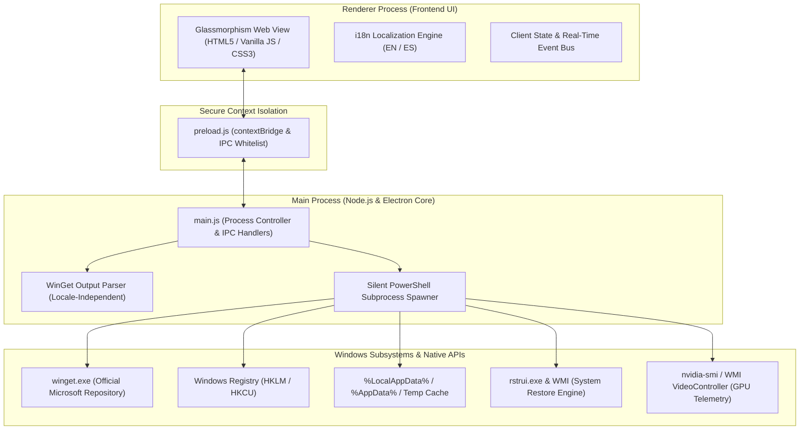

# 📖 Wingetix — Complete Technical & User Documentation

> **Wingetix: The Ultimate Open-Source Visual Control Panel & Software Manager for Windows 10 & 11**  
> *Version: 1.2.0 | License: GNU General Public License v3 (GPLv3)*

---

## 📑 Table of Contents
1. [Executive Summary & Vision](#1-executive-summary--vision)
2. [High-Level Architecture & Tech Stack](#2-high-level-architecture--tech-stack)
3. [Process Model & Inter-Process Communication (IPC)](#3-process-model--inter-process-communication-ipc)
4. [Deep Dive into Core Application Modules](#4-deep-dive-into-core-application-modules)
   - [4.1 Updates Dashboard & Batch Engine](#41-updates-dashboard--batch-engine)
   - [4.2 Clean Uninstaller & Deep Purge](#42-clean-uninstaller--deep-purge)
   - [4.3 Platform Shield (Game & Core Protection)](#43-platform-shield-game--core-protection)
   - [4.4 GPU Telemetry & Graphics Control](#44-gpu-telemetry--graphics-control)
   - [4.5 System Restore Points Integration](#45-system-restore-points-integration)
   - [4.6 Storage & Cache Cleaner](#46-storage--cache-cleaner)
   - [4.7 Package Pinning Manager](#47-package-pinning-manager)
   - [4.8 Internationalization (i18n) Engine](#48-internationalization-i18n-engine)
5. [Security, Privacy & Sandboxing Safeguards](#5-security-privacy--sandboxing-safeguards)
6. [Directory Structure & Source Code Layout](#6-directory-structure--source-code-layout)
7. [Build, Packaging & Distribution Pipeline](#7-build-packaging--distribution-pipeline)
8. [Roadmap & Upcoming Capabilities (v1.2.0)](#8-roadmap--upcoming-capabilities-v120)

---

## 1. Executive Summary & Vision

Microsoft Windows has historically lacked a unified, native, visual application manager. While Microsoft introduced the **Windows Package Manager (`winget`)**, its command-line interface poses friction for everyday users and non-technical administrators. Furthermore, legacy Windows maintenance utilities (e.g., CCleaner, IObit Uninstaller) have progressively degraded user trust through persistent background daemons, aggressive monetization, adware bundles, and telemetry collection.

**Wingetix** is engineered to resolve this gap. It serves as a modern, high-performance, glassmorphism desktop control panel that bridges Microsoft's official 12,000+ package catalog with deep system maintenance utilities:
- **Zero Console Popups:** Runs native WinGet and PowerShell operations invisibly with real-time stream parsing.
- **Deep Uninstallation:** Cleans orphaned registry keys and `%AppData%` folders without risking game installations.
- **Hardware Awareness:** Integrates direct GPU telemetry, driver verification, and VRAM monitoring.
- **System Safety:** Automatically coordinates native Windows Restore Points before performing modifications.
- **100% Free & Open Source:** Licensed under GNU GPLv3 with zero trackers, telemetry, or paywalls.

---

## 2. High-Level Architecture & Tech Stack

Wingetix is built on an asynchronous, multi-process architecture leveraging **Electron** and native Windows sub-systems.



### Key Technical Stack:
* **Runtime:** Node.js (v20+) & Electron (v32+).
* **Frontend:** Vanilla JavaScript (ES6+), semantic HTML5, pure CSS3 variables for modern Glassmorphism theme (backdrop-filter blur, CSS Grid, hardware-accelerated transitions).
* **Native Bridges:** Child Process (`spawn`, `exec`), File System (`fs`), Operating System (`os`), Windows Registry via PowerShell (`Get-ItemProperty`, `Microsoft.Win32.Registry`), WMI/CIM (`Win32_VideoController`, `SystemRestore`).
* **Packaging:** Inno Setup Compiler (`ISCC`) for installer generation, portable standalone archive compression (`zip`).

---

## 3. Process Model & Inter-Process Communication (IPC)

Wingetix implements Electron's **Context Isolation** security model:
1. **Renderer Process:** Does not have direct access to Node.js built-ins (`fs`, `child_process`). It operates strictly inside a sandboxed Chromium browser context.
2. **Preload Script (`preload.js`):** Exposes safe, validated asynchronous methods through `contextBridge.exposeInMainWorld('electronAPI', { ... })`.
3. **Main Process (`main.js`):** Listens on `ipcMain.handle` and `ipcMain.on` channels, verifies input arguments, executes OS-level operations with elevated administrator privileges, and streams progress back to the renderer via `event.sender.send()`.

### Key IPC Communication Channels:
| IPC Channel | Type | Direction | Description |
| :--- | :--- | :--- | :--- |
| `check-updates` | `handle` | Renderer ➔ Main ➔ Renderer | Invokes `winget upgrade`, parses tabular output, and returns outdated package list. |
| `update-package` | `on` | Renderer ➔ Main | Spawns background `winget upgrade --id <Id> --exact` with live stdout streaming. |
| `update-log` | `send` | Main ➔ Renderer | Streams terminal output and step-by-step progress to the live UI console. |
| `uninstaller:scan` | `handle` | Renderer ➔ Main ➔ Renderer | Gathers all installed Win32, MSI, and AppX software via registry and WinGet. |
| `uninstaller:deep-purge` | `handle` | Renderer ➔ Main ➔ Renderer | Executes uninstaller string + recursive purge of residual registry keys and AppData folders. |
| `gpu:detect-info` | `handle` | Renderer ➔ Main ➔ Renderer | Queries `nvidia-smi`, WMI, and registry to gather GPU names, VRAM, and driver states. |
| `cleaner:scan` | `handle` | Renderer ➔ Main ➔ Renderer | Calculates size of WinGet package cache, crash dumps, and temp setup installers. |
| `cleaner:purge` | `handle` | Renderer ➔ Main ➔ Renderer | Recursively removes selected temporary files and download caches. |
| `restore:create` | `handle` | Renderer ➔ Main ➔ Renderer | Invokes `Checkpoint-Computer` to create a named Windows Restore Point. |
| `restore:launch-wizard`| `on` | Renderer ➔ Main | Launches native `rstrui.exe` recovery wizard. |

---

## 4. Deep Dive into Core Application Modules

### 4.1 Updates Dashboard & Batch Engine
The **Updates** module provides visual control over pending application updates.

* **Locale-Independent Parser:** WinGet outputs headers in different languages depending on Windows display language (*Name, Id, Version, Available* vs *Nombre, Id, Versión, Disponible*). Wingetix utilizes a structural dash-anchor parser (`---  ---  ---`) that reads column indices based on character coordinates, ensuring 100% parsing accuracy across all international Windows editions.
* **Bulk Upgrades:** Users can select individual packages or execute *"Update Selected"* / *"Update All"*. Operations are sequenced through a resilient task queue with timeout handling and error catching.
* **Live Telemetry:** While upgrading, stdout chunks are parsed in real time to capture download percentages, download speeds (MB/s), and installation phases, showing an animated progress ring.

### 4.2 Clean Uninstaller & Deep Purge
Traditional Windows uninstallers often abandon gigabytes of telemetry data, cache folders, and registry configurations. Wingetix uses a **Two-Stage Uninstaller**:
1. **Stage 1 (Native Removal):** Invokes the software's registered `UninstallString` (or `winget uninstall --id <Id>`) with silent switches whenever supported.
2. **Stage 2 (Deep Residual Purge):**
   - Resolves application metadata (Publisher, Package Name, Executable Name).
   - Scans `%APPDATA%\<App>`, `%LOCALAPPDATA%\<App>`, and `%PROGRAMDATA%\<App>`.
   - Scans registry hives: `HKCU\Software\<Publisher>\<App>` and `HKLM\Software\<Publisher>\<App>`.
   - Deletes leftover orphaned files and keys, eliminating cumulative registry bloat.

### 4.3 Platform Shield (Game & Core Protection)
To prevent accidental deletion of critical software during deep uninstalls, Wingetix implements **Platform Shield**:
- **Blacklisted from Removal:** System files (`System32`, `SysWOW64`), Windows drivers, runtime libraries (`VCRuntime`, `.NET Desktop Runtime`).
- **Gaming Protection:** Explicit regex matching against gaming client ecosystems:
  - Steam (`steamapps`, library folders, `.vdf` configs).
  - Epic Games Store (`Manifests`, game install directories).
  - Riot Games (`Riot Vanguard`, `League of Legends`, `Valorant`).
  - Blizzard Battle.net, GOG Galaxy, EA App, Ubisoft Connect.
- If a target software resides inside a protected gaming directory, Platform Shield blocks recursive folder deletion to prevent wiping entire game libraries.

### 4.4 GPU Telemetry & Graphics Control
A dedicated hardware panel tailored for gamers, creative professionals, and developers:
* **Hardware Detection:** Queries Windows Display Adapter registry keys (`{4d36e968-e325-11ce-bfc1-08002be10318}`) and CIM `Win32_VideoController`.
* **Real-time Telemetry:**
  - NVIDIA: Hooks into `nvidia-smi` to display GPU Utilization %, Core Temperature (°C), Total VRAM vs Used VRAM (MB/GB), and Board Power Draw (Watts).
  - AMD & Intel: Reads official driver dates, versions, and current active display resolution / refresh rate (Hz).
* **One-Click Driver Upgrades:** Detects installed companion suites (*NVIDIA App, GeForce Experience, AMD Radeon Software, Intel Arc Control*) and offers 1-click installations via WinGet if missing.

### 4.5 System Restore Points Integration
Because system-level operations carry inherent risk, Wingetix embeds automated backup protection:
* **One-Click Snapshot:** Calls Windows native `Checkpoint-Computer` cmdlet with type `APPLICATION_UNINSTALL` or `MODIFY_SETTINGS`.
* **History Inspector:** Lists all existing restore points stored on the system drive with exact timestamps and descriptions.
* **System Rollback Wizard:** Embedded shortcut to spawn `rstrui.exe`, allowing immediate rollbacks even if an external application installer crashes the OS.

### 4.6 Storage & Cache Cleaner
Cleans disk space wasted by installers and temporary buffers:
* **WinGet Download Cache:** Clears `%LOCALAPPDATA%\Microsoft\WinGet\Packages` and `LocalCache` where WinGet preserves multi-gigabyte `.msi` and `.exe` installers after installation.
* **User Temp Files:** Clears `%LOCALAPPDATA%\Temp` files older than active locks.
* **Crash Dumps & WER:** Purges Windows Error Reporting archives (`ReportArchive`, `ReportQueue`) and application memory dumps (`CrashDumps`).

### 4.7 Package Pinning Manager
Integrates directly with Microsoft's native pinning framework:
* **Freeze Versions (`winget pin add`):** Users can click the **Pin icon (📌)** on any application to freeze it at its current version.
* **Why it matters:** Prevents applications with perpetual licenses (e.g., Clip Studio Paint 4 vs paid v5) or critical production dependencies from updating during batch runs.
* **Management UI:** A dedicated filter shows all pinned packages with quick unpinning controls.

### 4.8 Internationalization (i18n) Engine
* **Bi-lingual Support:** Full native support for **English (en)** and **Spanish (es)**.
* **Dynamic Translation:** Strings are structured in `i18n.js` with semantic keys (`i18n.t('key')`).
* **Zero Restart:** Language can be swapped on the fly from the title bar dropdown, immediately updating UI text nodes and DOM attributes.
* **Installer Persistence:** The Inno Setup language choice is recorded to `installed_lang.txt`, allowing the app to open in the user's selected language on first run.

---

## 5. Security, Privacy & Sandboxing Safeguards

| Concern | Wingetix Implementation |
| :--- | :--- |
| **Telemetry & Privacy** | **Zero Telemetry.** No Google Analytics, no telemetry pings, no advertising SDKs, no external tracking servers. |
| **Execution Security** | Child processes run with `-NoProfile -NonInteractive -ExecutionPolicy Bypass` and sanitize input parameters against shell injection. |
| **Privilege Model** | Requires Windows Administrator privileges (`requireAdministrator`) exclusively to write to registry hives and install/uninstall software. |
| **Network Boundaries** | The application does not host external servers; all package downloads originate from Microsoft's official CDN and package source mirrors. |
| **License Compliance** | Released under **GNU GPLv3**. The entire codebase is transparent, reproducible, and verifiable on GitHub. |

---

## 6. Directory Structure & Source Code Layout

```text
Wingetix/
├── build/                      # Build assets, application icons (icon.ico, icon.png)
├── dist/                       # Packaged Electron binaries (win-unpacked)
├── docs/                       # Screenshots, architecture specifications, documentation
│   ├── screenshots/            # HD captures of each module (01-updates to 06-quick-menu)
│   └── DOCUMENTATION.md        # Complete technical documentation (this file)
├── scripts/                    # Native PowerShell helper scripts
│   ├── attach-icons.ps1        # Resolves app icons from executable resources
│   ├── enable-winget.ps1       # Automated WinGet registration & dependency repair
│   └── list-installed.ps1      # Fast registry enumeration of installed software
├── i18n.js                     # Internationalization dictionaries (EN & ES)
├── index.html                  # Main application DOM, modal structures, navigation
├── main.js                     # Electron main process (IPC handlers, process spawn)
├── preload.js                  # Context bridge script (safe API exposure)
├── renderer.js                 # Frontend application logic, UI controllers, events
├── styles.css                  # Glassmorphism design system, CSS variables, animations
├── Wingetix-Setup.iss          # Inno Setup compiler script for building setup executables
├── package.json                # Project dependencies, scripts, build configuration
└── README.md                   # Repository landing guide, badges, and quick start
```

---

## 7. Build, Packaging & Distribution Pipeline

### Step 1: Install Dependencies
```bash
npm install
```

### Step 2: Build Electron Distribution
Compiles the application into a standalone 64-bit Windows executable package (`dist/win-unpacked`):
```bash
npm run build
```

### Step 3: Compile Inno Setup Installer
Generates `Wingetix-Setup-1.1.1.exe` with multilingual wizard support and integrated WinGet activation task:
```bash
iscc Wingetix-Setup.iss
```

---

## 8. Roadmap & Upcoming Capabilities (v1.2.0)

1. **Software Bundles & Rapid PC Setup (Ninite-style):**
   - Export installed application profiles to portable `.wingetix-bundle` files.
   - 1-Click bulk deployment for newly formatted PCs or enterprise deployment.
   - Pre-configured bundles: *Office Essentials*, *Gamer Setup*, *Developer Workstation*.
2. **First-Run WinGet Auto-Repair Wizard:**
   - Detects missing `winget.exe` on Windows LTSC or broken systems and offers a 1-click visual repair wizard with progress bar.
3. **Multi-GPU Selector:**
   - Dedicated toggle pills for systems with both integrated (iGPU) and discrete (dGPU) graphics cards, ensuring discrete cards are prioritized by default.
4. **Pure Portable Mode (Zero Footprint USB):**
   - Configures settings to store in local `.\data\settings.json` when running on removable USB media.

---

*Authored by Jose Antonio Baeza Pineda & The Wingetix Open Source Community.*  
*Official Website: [wingetix.com](https://wingetix.com) | GitHub: [github.com/joselyky/Wingetix](https://github.com/joselyky/Wingetix)*
